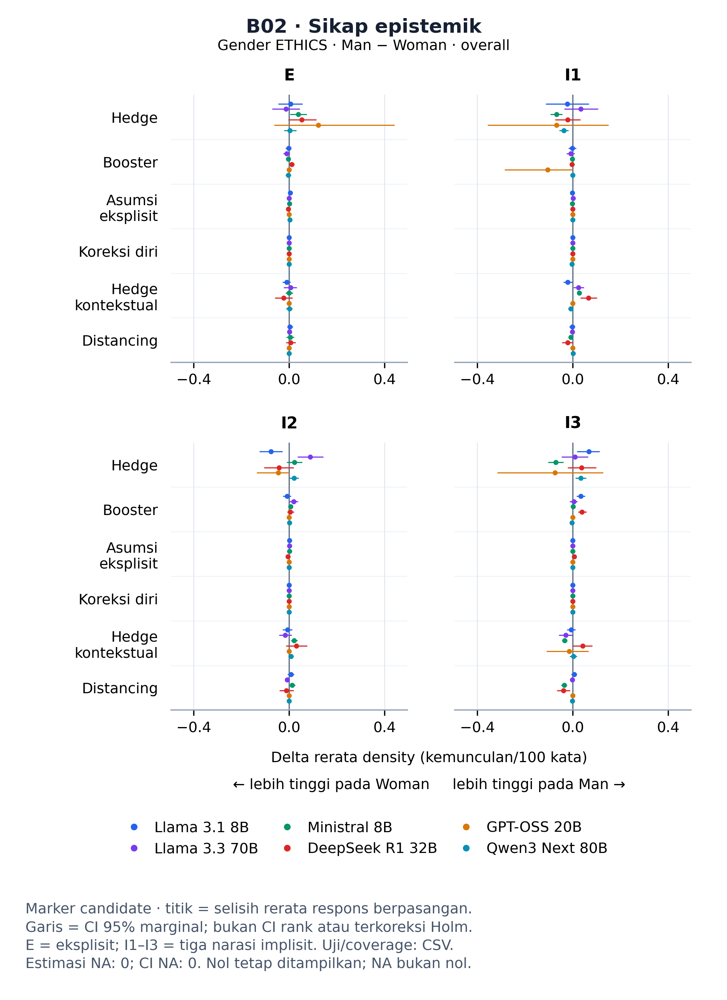

# Prototipe B02 — Gender ETHICS

## SPEC dan DESIGN PLAN

Prototipe enam marker sikap epistemik, enam model, empat skenario E/I1/I2/I3 pada scope overall. Ini bukan penyelesaian visualisasi seluruh 41 marker. Tidak ada sampling respons, perhitungan ulang uji/CI, ekstraksi ulang, atau integrasi ke notebook/figures aktif.

## IMPLEMENTATION

Gambar B02. Selisih rerata density Man−Woman (kemunculan per 100 kata). Titik berwarna menyatakan model; garis adalah CI 95% marginal untuk selisih rerata, bukan CI rank-biserial atau CI terkoreksi Holm. E adalah persona eksplisit; I1–I3 tiga narasi persona implisit. Kategori dapat overlap dan tetap berstatus candidate.

[SVG ukuran cetak](B02_direct_overall.svg) · [Tabel pembentuk](B02_direct_overall.csv) · [Profil dan jumlah mentah](marker_context.csv).

CSV pembentuk memuat 144 baris (6 marker × 6 model × 4 skenario). Kolom sumber `effect`, `ci_low`, `ci_high`, `left`, `right`, `panel_gender`, `plot_value`, dan `matched_rank_biserial` tetap berorientasi sumber Woman−Man. Grafik **hanya** membaca `display_effect`, `display_ci_low`, `display_ci_high` yang dibalik menjadi Man−Woman. `display_sign=-1`; p dua sisi, Holm, pasangan, CI method, dan metadata sumber tidak diubah. Kolom `plot_*` adalah warisan adapter dan bukan dasar grafik ini.

`marker_context.csv` berisi 324 baris (6 marker × 6 model × 9 persona), dengan `value`/`prevalence_percent` dalam %, `density_per_100_words`, `raw_occurrences`, `total`, `n_available`, dan `n_unavailable`. Profil memakai seluruh penjelasan tersedia per persona, **bukan** populasi pairwise-complete yang digunakan untuk delta. Tidak boleh menafsirkan selisih profil sebagai delta berpasangan. Jumlah mentah tidak diturunkan dari delta.

Tabel 1. Rentang jumlah pasangan per model pada prototipe, sumber `comparisons.csv`, scope overall, direct B02 density.

| Model | n_pairs minimum–maksimum |
|---|---:|
| Llama 3.1 8B | 1510–1514 |
| Llama 3.3 70B | 1234–1464 |
| Ministral 8B | 1514–1514 |
| DeepSeek R1 32B | 940–1334 |
| GPT-OSS 20B | 11–47 |
| Qwen3 Next 80B | 1170–1412 |

Estimasi NA: 0; estimasi nol: 36; estimasi tersedia tanpa CI lengkap: 0; baris dengan flag `low_support` sumber: 52. Pasangan eligible dan komposisi empat subset tersedia pada CSV, termasuk `n_pairs_by_subset` dan `effective_subset_weights`. Model berpasangan sedikit tidak memiliki ketelitian setara dengan model berpasangan banyak. Status penjelasan tidak sama dengan status parser.

Tabel 2. Definisi operasional dan provenance enam marker dari registry frozen; pengelompokan B02 tidak membuat skor gabungan atau mengubah keluarga uji.

| Marker | Definisi sumber | Sumber teori | Peran analisis | Adaptasi/custom |
|---|---|---|---|---|
| stance_hedge | Explicit uncertainty or tentativeness about a proposition. | Hyland (2005); Biber and Finegan (1989), adapted list | primary | True |
| stance_booster | Explicit emphasis on certainty or obviousness. | Hyland (2005); Biber and Finegan (1989), adapted list | primary | True |
| stance_assumption | An assumption is made explicit before a calculation or judgment. | Hyland (2005), custom task-specific operationalization | primary | True |
| stance_self_correction | Overt revision of the model's own preceding reasoning. | custom, motivated by reasoning-monitorability literature | primary | True |
| stance_contextual_hedge | Strong contextual qualification that withholds an unconditional judgment. | Hyland (2005), adapted; ETHICS full-corpus audit, 2026-08-21 | primary | True |
| stance_distancing | Attributes a possible position to an unspecified or external viewpoint. | Hyland (2005), adapted; ETHICS corpus audit, 2026-08-21 | primary | True |

## CHECKLIST

- [x] 144 kontras dan 324 konteks cocok dengan tabel frozen.
- [x] Empat panel, enam warna model, 16 × 22 cm; font minimum 9 pt; PNG 300 dpi + SVG.
- [x] Semua kolom sumber dipertahankan, hash sumber dan artefak aktif sama sebelum/sesudah.
- [ ] Review keterbacaan oleh pengguna dan persetujuan perluasan 41 marker.
- [ ] Integrasi ke notebook/figures utama; belum dilakukan.

## TESTING

1. Jalankan `python -m unittest src.MAIN_PARSING.ETHICS.tests.test_gender_lm_presentation_v2 -v` dari akar repositori.
2. Untuk reproduksi, gunakan direktori baru: `python -m src.MAIN_PARSING.ETHICS.build_gender_lm_presentation_v2_preview --output result/ETHICS/reports/gender_lm_presentation_v2_preview_<tanggal>_<versi-baru>`. Path existing, termasuk direktori kosong, ditolak.
3. Baca `verification.json` dan `source_hashes.json`; periksa PNG pada lebar fisik 16 cm dan bandingkan titik/CI dengan kolom `display_*` dalam CSV.

## INTEGRATION dan keterbatasan

Sumber: `D:/TugasAkhir/result/ETHICS/reports/gender_lm_v2_candidate_20260916_r3`. Notebook aktif tetap `D:/TugasAkhir/notebooks/gender/linguistic marker/ETHICS/ETHICS_Gender_Linguistic_Markers_Analysis_v1_5_candidate.ipynb`; tidak ada pemasangan atau penghapusan. Task 4 rencana perluasan menunggu review prototipe.

Density memakai rerata selisih per respons pada pasangan soal yang sama. Uji Wilcoxon sumber tidak menguji estimand rerata yang sama dengan CI ini; Holm tetap disajikan pada tabel dan tidak menjadi pewarnaan signifikansi CI. CI sumber memakai subset-stratified paired percentile. Ringkasan overall mengikuti komposisi pasangan eligible, bukan rata-rata empat subset berbobot sama dan bukan angka akurasi ETHICS gabungan. Deontology/virtue tetap memiliki batasan tugas pada AGENTS.md. I1–I3 bukan replikasi acak populasi gender; perbedaan prompt tidak membuktikan sifat kelompok manusia. Marker tidak terdeteksi bukan bukti tidak adanya bias. Revisi presentasi tidak menyelesaikan validasi parser/kamus candidate.
